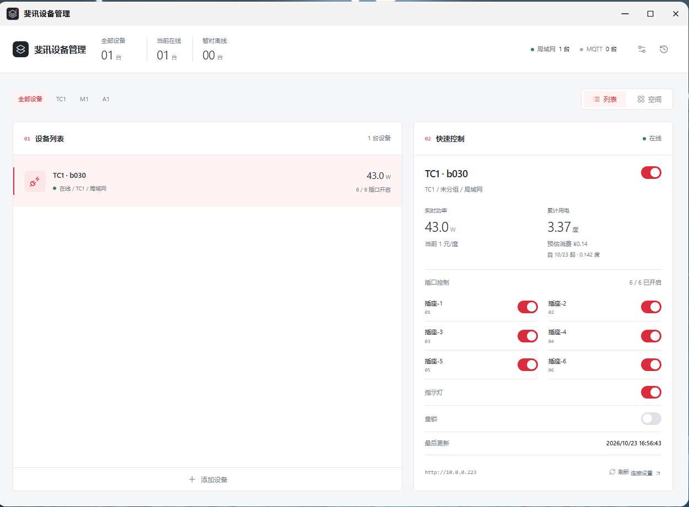
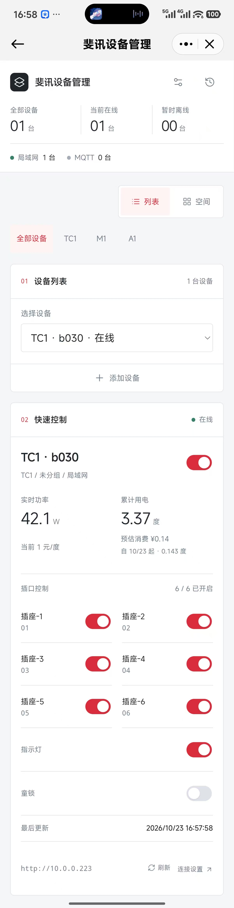

# 斐讯设备管理 · fnOS

基于 [phicomm-io 斐讯设备社区项目](https://github.com/phicomm-io/)制作的 fnOS 原生控制工具，在飞牛 NAS 上集中管理 TC1 智能排插、M1 空气检测仪和 A1 空气净化器。由 [情深深雨蒙蒙（yueqihe）](https://github.com/yueqihe) 独立维护。

使用 Go 后端和 React 前端，网页、SQLite 数据库和 MQTT 服务均内置于程序。NAS 无需安装 Node.js、Go、独立数据库或 Docker，支持局域网直连与 TMCP v2 MQTT 接入。

## 界面预览

桌面端：



手机端：



以上为早期版本的实机截图；当前版本已去掉页面顶部重复的图标、应用标题和手动刷新按钮，设备状态自动更新。

## 下载安装

需要 fnOS 1.2.0 及以上，以及刷入兼容社区固件的 TC1 / M1 / A1。[查看最新版本](https://github.com/yueqihe/phicomm-fnos-manager/releases/latest)。

| NAS 架构 | 0.2.4 安装包 |
| --- | --- |
| ARM64 / AArch64 | [phicomm-manager-0.2.4-arm.fpk](https://github.com/yueqihe/phicomm-fnos-manager/releases/download/v0.2.4/phicomm-manager-0.2.4-arm.fpk) |
| x86-64 / AMD64 | [phicomm-manager-0.2.4-x86.fpk](https://github.com/yueqihe/phicomm-fnos-manager/releases/download/v0.2.4/phicomm-manager-0.2.4-x86.fpk) |

1. 在飞牛应用中心选择手动安装，上传对应架构的 FPK。
2. 使用飞牛管理员账号，从桌面打开“斐讯设备管理”，无需再设置应用管理密码。
3. 点击列表或空间视图下方的“添加设备”，扫描设备或填写设备内网地址。
4. 在“设置”中调整设备连接、MQTT 服务和电价；“外观”可选择浅色、深色或跟随系统，即时生效并记住此设备的偏好。

从 0.1.x / 0.2.0 / 0.2.1 / 0.2.2 / 0.2.3 升级时保留应用数据，即可继续使用原设备、空间、连接凭据、历史和电费记录。详细操作与备份方式见 [安装说明](fnos/INSTALL.md)。

## 通过 fnOS 远程控制

可以借助 fnOS 自带的远程访问，在外网打开本工具并查看、控制家中的设备：

1. 先确认 NAS 能通过局域网或 MQTT 正常连接设备。
2. 在 fnOS 中启用并配置远程访问。
3. 在外网登录飞牛，通过桌面的“斐讯设备管理”入口打开应用。

控制请求由 NAS 转发给设备，设备网页和 MQTT 无需单独映射到公网。应用通过 fnOS 统一网关及管理员身份访问；是否可从外网打开，以 NAS 的远程访问和应用入口配置为准。

## 功能

- TC1 / M1 / A1 集中查看与控制，支持设备列表、按空间管理和手机自适应界面。
- 同一设备的局域网与 MQTT 连接按型号和 MAC 合并，接入时核验设备身份。
- 一个“扫描设备”入口结合 mDNS / DNS-SD 与局域网探测，自动选择局域网接口并过滤容器网桥等虚拟接口；支持进度、停止，以及高级网卡 / 网段设置。
- 内置 MQTT Broker，也可连接外部 Broker；支持 TMCP v2 自动发现、设备凭据和主题权限，外部连接可使用 TLS。
- 设备连接、服务设置、控制和历史通过弹窗操作。
- 浅色 / 深色 / 跟随系统主题，覆盖设备列表、空间卡片、控制和设置弹窗。
- TC1 用电换算为“度”，支持统一电价与峰谷电价，显示当前单价和预估消费。
- SQLite 本地保存数据，连接凭据使用 AES-256-GCM 加密，沿用旧版 `secrets.key`。

状态自动更新：局域网设备默认每 15 秒采集一次，MQTT 状态随设备上报更新；页面每 5 秒同步最新数据，切回前台或网络恢复时立即同步，无需手动刷新。

电费从首次有效读数开始累计，不追溯未知历史。峰谷按北京时间每日一段谷时计算，支持跨午夜；两次读数间的电量按时间比例分摊，消费金额供参考。

## 开发与构建

后端需要 Go 1.25+；FPK 打包需要 Python 3 和 [fnpack](https://github.com/ckcoding/fnnas-docs)。前端编译与浏览器测试使用 Node.js 22 / 24，仅用于开发电脑。

已提交 React 静态产物，直接构建 Go 或 FPK 无需 Node.js：

```sh
go test ./...
go vet ./...
python scripts/verify-web.py
python scripts/build-fpk.py --platform arm
python scripts/build-fpk.py --platform x86
```

Windows 可使用 `py -3` 替代 `python`。将 Go 和 fnpack 加入 PATH，或分别用 `GO_BIN`、`FNPACK` 环境变量指定路径。构建输出位于 `release/phicomm-manager/`，包含 FPK、SHA256 和安装说明；两种架构分别静态编译，不依赖 NAS 的语言运行时。

修改前端后，在开发电脑重新生成静态文件并验证：

```sh
npm ci
npm run build:web
npm run test:browser
```

浏览器测试需要先运行 `npx playwright install chromium`，或通过 `PLAYWRIGHT_CHROMIUM_EXECUTABLE` 指定已安装的 Chromium。打包前会检查源码与静态产物的 SHA256，避免将旧网页打入新包。

本机预览：

```sh
go run . --dev --listen 127.0.0.1:8800 --base / --data ./dev-data
```

`--dev` 仅允许回环地址。fnOS 正式服务使用本地 Unix Socket，经统一网关访问，不额外开放 HTTP 管理端口。

## 项目结构

| 路径 | 内容 |
| --- | --- |
| 根目录 Go 文件 | REST API、设备协议、发现、MQTT、SQLite 与电费 |
| `frontend/` | React 组件与样式 |
| `public/` | 编译后的网页、构建校验信息和前端许可证 |
| `fnos/` | FPK 安装模板、生命周期脚本与桌面入口 |
| `scripts/` | 前端构建、FPK 打包与产物校验 |
| `test/`、`native_*_test.go` | 浏览器测试、Go 测试和合成设备 / 迁移样本 |

验证覆盖设备控制、旧版 TC1 兼容、MQTT 权限、统一扫描、旧数据迁移、电费及 320–1440px 页面。FPK 会检查架构、静态链接、权限和网关配置；fnOS 实机安装仍待验证。

## 项目来源与致谢

本工具根据 [phicomm-io](https://github.com/phicomm-io/) 社区项目的设备协议、固件生态和公开资料制作，面向 fnOS 提供独立管理界面。设备需使用兼容的社区固件，原厂固件不保证可接入。

本仓库只发布 fnOS 管理端及其构建、测试文件，不包含上游设备固件、SDK 或 `phicomm-io.github.io` 站点源码。FPK 也不附带这些原项目源码；以下链接用于说明项目来源和查阅设备资料。

- [社区文档、设备资料与下载](https://phicomm-io.github.io/)
- [phicomm-community-frontend](https://github.com/phicomm-io/phicomm-community-frontend)
- [phicomm-community-mqtt](https://github.com/phicomm-io/phicomm-community-mqtt)
- [fnOS 开发文档参考](https://github.com/ckcoding/fnnas-docs)

感谢上游作者和贡献者。第三方组件保留各自的授权声明，详见 [项目来源与第三方组件](THIRD_PARTY_NOTICES.md)。
